<h1 align="center">AI Code Reviewer</h1>

<p align="center">
  <em>An automated code reviewer powered by a plugged-in language model, with a bug-catching evaluation harness. It is measured on a labeled benchmark of bug-introducing diffs, so its value is a number, not a vibe.</em>
</p>

<p align="center">
  <a href="https://github.com/adeoluo/ai-code-reviewer/actions/workflows/ci.yml"></a>
  
  
  
  
  
</p>

---

## Motivation

Automated code-review tools are easy to build and hard to trust, because almost none of them are
evaluated: they emit comments, and nobody measures whether those comments catch real bugs. This
project is built the other way around. It is a review pipeline (parse a diff, prompt a model, parse
structured comments) **plus a labeled benchmark** of diffs that introduce real defects, so every
change to the reviewer is scored on **precision and recall of catching bugs**.

The reviewer depends only on a small provider interface. A **deterministic, offline provider**
powers continuous integration and the benchmark, so results are reproducible with no credentials;
a **real Claude provider**, built on the standard library with no third-party dependency, powers
production. The review logic, prompting, and parsing are identical in both.

## Architecture

<p align="center">
  
</p>

A unified diff is parsed to its added lines, embedded in a prompt, and sent to the provider, which
returns comments as JSON that are parsed into structured findings. The same pipeline runs against
the labeled benchmark to produce precision and recall. See the [ADRs](docs/adr/) for the key
decisions.

## Results

> Reproduce with `python -m ai_code_reviewer evaluate`. The benchmark has diffs that introduce real
> defects (mutable defaults, bare excepts, `== None`, `eval`, hardcoded secrets, `shell=True`, SQL
> built by concatenation, `assert` used for validation) and clean diffs that must not be flagged.

| Metric (13 labeled diffs) | Value |
|---|---:|
| **precision** | **1.000** |
| **recall** | **0.800** |
| F1 | 0.889 |

The reviewer catches **80% of planted bugs at 100% precision**: it never flags a clean line, and it
misses exactly the two **semantic** bugs (an off-by-one `range(len(x) + 1)` and a logic error
`if role == "admin" or "root":`) that pattern rules cannot see. Those misses are the honest case
for a language model: swapping the offline provider for Claude is where recall on semantic bugs
improves, with the benchmark in place to prove it.

## Demonstration

```text
$ python -m ai_code_reviewer review --case 4
  client.py:3 [high] hardcoded secret; load from the environment instead

$ python -m ai_code_reviewer evaluate
Bug-catching evaluation on the labeled benchmark:
  precision=1.000, recall=0.800, f1=0.889 over 13 cases (TP=8, FP=0, FN=2)
  missed (semantic bugs pattern rules cannot catch): off_by_one, logic_always_true
```

## Using a real model in production

```python
from ai_code_reviewer import AnthropicProvider, Reviewer

reviewer = Reviewer(provider=AnthropicProvider())  # reads ANTHROPIC_API_KEY
review = reviewer.review(open("change.diff").read())
for comment in review.comments:
    print(comment.path, comment.line, comment.severity, comment.message)
```

The `AnthropicProvider` calls the Claude Messages API over HTTPS using only the standard library,
so there is still no third-party runtime dependency. It is never exercised by the test suite; CI
uses the offline provider.

## Quickstart

```bash
git clone https://github.com/adeoluo/ai-code-reviewer.git && cd ai-code-reviewer
make setup                      # install dev tooling + pre-commit hooks
make all                        # lint + type-check + test

python -m ai_code_reviewer evaluate          # precision and recall on the benchmark
python -m ai_code_reviewer review --case 0    # review a built-in benchmark diff
git diff | python -m ai_code_reviewer review --stdin   # review your own diff
python -m ai_code_reviewer serve              # start the HTTP service on :8000
```

## HTTP service

A standard-library HTTP service reviews diffs and reports its benchmark score. The routing logic is
a pure function, tested without a socket. Under a concurrent stress benchmark
(`uv run python benchmarks/stress.py`, 10000 requests, 8 workers) the `/review` handler sustains
roughly **9,000 requests/second** at **p50 0.06 ms** with the offline provider.

| Method | Path | Purpose |
|---|---|---|
| GET | `/health` | liveness and the active provider name |
| GET | `/ready` | readiness |
| GET | `/metrics` | per-route request, error, and latency metrics (Prometheus text) |
| POST | `/review` | body `{"diff": str}`; review comments for the diff |
| GET | `/evaluate` | bug-catching precision and recall on the built-in benchmark |

## Design decisions

- **A provider interface with an offline fake** - keeping the model behind a protocol lets CI and
  the benchmark run deterministically while production calls Claude. See
  [ADR 0002](docs/adr/0002-provider-interface.md).
- **Evaluate on labeled bug-introducing diffs** - a review tool is only as good as its measured
  bug-catching rate; the benchmark is the point. See [ADR 0003](docs/adr/0003-bug-benchmark.md).

## Evaluation

The benchmark and offline provider are deterministic, so every number reproduces offline. Full
method and tables: [`docs/EVALUATION_REPORT.md`](docs/EVALUATION_REPORT.md).

## Responsible AI

- **Model card:** [`docs/MODEL_CARD.md`](docs/MODEL_CARD.md)
- **Data card:** [`docs/DATA_CARD.md`](docs/DATA_CARD.md)
- **Threat model:** [`docs/THREAT_MODEL.md`](docs/THREAT_MODEL.md)

## Limitations

- The offline provider is a pattern-based detector; it catches recognizable defects but not
  semantic bugs. A language model is needed for the latter, which is exactly what the benchmark is
  there to measure.
- The benchmark is small and curated. It is a regression guard for the pipeline, not a claim about
  real-world recall.
- The diff parser handles unified diffs; it does not resolve renames or binary patches.

## Roadmap

- [ ] Expand the benchmark with real bug-fix commits mined from open-source history.
- [ ] Add inline posting to a pull request through the hosting platform's API.
- [ ] Add a confidence score per comment and a severity threshold.

## License

[MIT](LICENSE)
