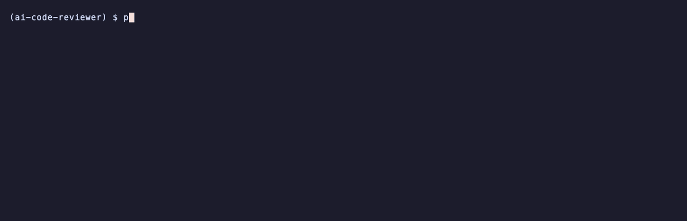
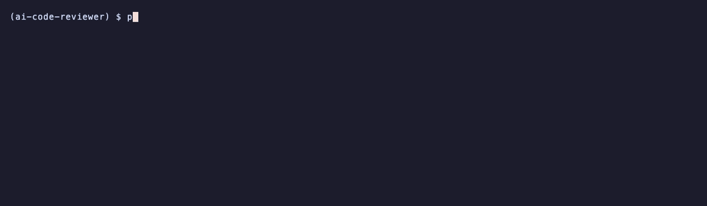
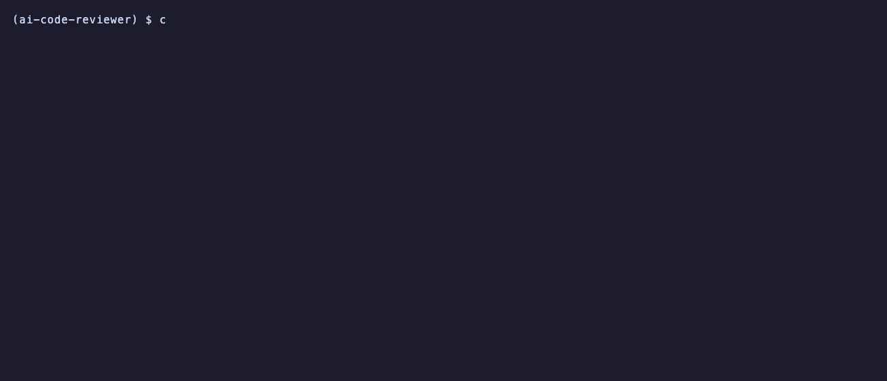

<h1 align="center">AI Code Reviewer</h1>

<p align="center">
  <em>An automated code reviewer powered by a plugged-in language model, with an evaluation harness that measures bug-catching precision and recall on a labeled benchmark of bug-introducing diffs.</em>
</p>

<p align="center">
  <a href="https://github.com/adeoluo/ai-code-reviewer/actions/workflows/ci.yml"></a>
  <a href="https://github.com/adeoluo/ai-code-reviewer/releases"></a>
  
  <a href="LICENSE"></a>
</p>

---

## Motivation

Automated code-review tools are easy to build and hard to trust, because almost none of them are
evaluated: they emit comments, and nobody measures whether those comments catch real bugs. This
project is built the other way around. It is a review pipeline (parse a diff, prompt a model, parse
structured comments) **plus a labeled benchmark** of diffs that introduce real defects, so every
change to the reviewer is scored on **precision and recall of catching bugs**.

The reviewer depends only on a small provider interface. A **deterministic, offline provider**
powers continuous integration and the benchmark, so results are reproducible with no credentials;
a **real Claude provider** powers production. The review logic, prompting, and parsing are identical in both.

## Architecture

<p align="center">
  
</p>

<sub>Legend: amber = entry points and external systems, indigo = core logic, green = data and state, blue = validation and control, grey = observability and outputs.</sub>

A diff arrives through the HTTP service (validated and size-capped) or the CLI. The reviewer
embeds it in a prompt and calls a provider through one `complete(system, prompt)` protocol: the
default offline `FakeProvider` parses the diff to its added lines and runs the rule detector,
while `AnthropicProvider` sends the same prompt to Claude. Either way the reply is JSON that is
parsed into structured comments, dropping malformed items. The same pipeline runs over the labeled
benchmark to produce line-level precision and recall, and every HTTP route is timed into
Prometheus metrics. See the [ADRs](docs/adr/) for the key decisions.

## Results

> Reproduce with `python -m ai_code_reviewer evaluate`. The benchmark has diffs that introduce real
> defects (mutable defaults, bare excepts, `== None`, `eval`, hardcoded secrets, `shell=True`, SQL
> built by concatenation, `assert` used for validation) and clean diffs that must not be flagged.
>
> These numbers come from the deterministic offline provider and are reproduced by the test suite in continuous integration (no network, no credentials). In production the provider is Claude behind the same interface, which is where recall on the semantic bugs the pattern rules miss is expected to improve.

| Metric (13 labeled diffs) | Value |
|---|---:|
| **precision** | **1.000** |
| **recall** | **0.800** |
| F1 | 0.889 |

The reviewer catches **80% of planted bugs at 100% precision**: it never flags a clean line, and it
misses exactly the two **semantic** bugs (an off-by-one `range(len(x) + 1)` and a logic error
`if role == "admin" or "root":`) that pattern rules cannot see. Those misses are the honest case
for a language model: swapping the offline provider for Claude is where recall on semantic bugs
improves, with the benchmark in place to prove it.

### Scale

To check that the reviewer holds up on large pull-request volumes, `benchmarks/scale.py` runs
`Reviewer.review` over growing sets of synthetic diffs, each planting one rule-detectable bug among
clean added lines, and times the review loop while tracking the workload's peak memory with the
standard-library `tracemalloc`. The data is synthetic and the numbers are environment-specific; on
this clean set precision and recall stay at 1.000 (every planted bug is a pattern the rules catch),
throughput stays roughly flat, and memory grows linearly with the number of diffs.

| Diffs | Wall-clock (s) | Throughput (diffs/s) | Peak memory (MiB) | Precision | Recall |
|---:|---:|---:|---:|---:|---:|
| 8,000 | 1.22 | ~6,570 | 2.79 | 1.000 | 1.000 |
| 20,000 | 3.54 | ~5,660 | 6.87 | 1.000 | 1.000 |
| 40,000 | 5.86 | ~6,830 | 13.85 | 1.000 | 1.000 |
| 80,000 | 15.47 | ~5,170 | 27.81 | 1.000 | 1.000 |

The precision/recall here reflect only rule-detectable bugs on synthetic diffs and come from the
deterministic offline provider; production swaps in a real language-model API behind the same
interface, which is where recall on semantic bugs improves. Reproduce with
`uv run python benchmarks/scale.py`.

### Evaluation

The benchmark and offline provider are deterministic, so every number reproduces offline. Full
method and tables: [`docs/EVALUATION_REPORT.md`](docs/EVALUATION_REPORT.md).

## Quickstart

```bash
git clone https://github.com/adeoluo/ai-code-reviewer.git && cd ai-code-reviewer
make setup                      # install dev tooling + pre-commit hooks
make all                        # lint + type-check + test

python -m ai_code_reviewer evaluate          # precision and recall on the benchmark
python -m ai_code_reviewer review --case 0    # review a built-in benchmark diff
git diff | python -m ai_code_reviewer review --stdin   # review your own diff
python -m ai_code_reviewer serve              # start the HTTP service on :8000
```

## Usage

### Demonstration

```text
$ python -m ai_code_reviewer review --case 4
  client.py:3 [high] hardcoded secret; load from the environment instead

$ python -m ai_code_reviewer evaluate
Bug-catching evaluation on the labeled benchmark:
  precision=1.000, recall=0.800, f1=0.889 over 13 cases (TP=8, FP=0, FN=2)
  missed (semantic bugs pattern rules cannot catch): off_by_one, logic_always_true
```

### Using a real model in production

```python
from ai_code_reviewer import AnthropicProvider, Reviewer

reviewer = Reviewer(provider=AnthropicProvider())  # reads ANTHROPIC_API_KEY
review = reviewer.review(open("change.diff").read())
for comment in review.comments:
    print(comment.path, comment.line, comment.severity, comment.message)
```

The `AnthropicProvider` calls the Claude Messages API over HTTPS with the standard-library HTTP
client. It is never exercised by the test suite; CI uses the offline provider.

### HTTP service

A standard-library HTTP service reviews diffs and reports its benchmark score. The routing logic is
a pure function, tested without a socket. Under a concurrent stress benchmark
(`uv run python benchmarks/stress.py`, 10000 requests, 8 workers) the `/review` handler sustains
roughly **9,000 requests/second** at **p50 0.06 ms** with the offline provider.

| Method | Path | Purpose |
|---|---|---|
| GET | `/health` | liveness and the active provider name |
| GET | `/ready` | readiness |
| GET | `/metrics` | per-route request, error, and latency metrics (Prometheus text) |
| POST | `/review` | body `{"diff": str}`; review comments for the diff |
| GET | `/evaluate` | bug-catching precision and recall on the built-in benchmark |

### Demos

Recorded from real runs with [vhs](https://github.com/charmbracelet/vhs); each tape is in `docs/demo/`.

Two reviews of bundled diffs, with the findings for each.

<p align="center">
  
</p>

Precision and recall of the reviewer on the labeled cases.

<p align="center">
  
</p>

The HTTP service reviewing a diff with a mutable default and a hardcoded secret.

<p align="center">
  
</p>

## Design decisions

- **A provider interface with an offline fake** - keeping the model behind a protocol lets CI and
  the benchmark run deterministically while production calls Claude. See
  [ADR 0002](docs/adr/0002-provider-interface.md).
- **Evaluate on labeled bug-introducing diffs** - a review tool is only as good as its measured
  bug-catching rate; the benchmark is the point. See [ADR 0003](docs/adr/0003-bug-benchmark.md).

## Testing

```bash
make test                     # or: uv run pytest
uv run pytest --cov=src --cov-report=term-missing --cov-fail-under=80
```

The suite in `tests/` runs offline against the deterministic provider:

- `test_reviewer.py`: unified diff parsing (added lines, line numbers, removed lines
  ignored), the rule detectors on known defects and on clean code, prompt construction,
  parsing of provider output including non-JSON responses, and the benchmark evaluation
  (precision, recall, and no comments on clean cases).
- `test_service_cli.py`: the HTTP handler layer (`/health`, `/ready`, `/review`,
  `/evaluate`, `/metrics`, validation, unknown routes) and the CLI commands.

The `AnthropicProvider` needs network access and credentials, so it is excluded from the
suite. CI (`.github/workflows/ci.yml`) runs `ruff format --check`, `ruff check`, `mypy src`,
and `pytest` with an 80% coverage gate on Python 3.12, 3.13, 3.14 and 3.15, then builds the package and
the Docker image.

## Responsible AI

- **Model card:** [`docs/MODEL_CARD.md`](docs/MODEL_CARD.md)
- **Data card:** [`docs/DATA_CARD.md`](docs/DATA_CARD.md)
- **Threat model:** [`docs/THREAT_MODEL.md`](docs/THREAT_MODEL.md)

## Limitations

- The offline provider is a pattern-based detector; it catches recognizable defects but not
  semantic bugs. A language model is needed for the latter, which is exactly what the benchmark is
  there to measure.
- The benchmark is small and curated. It is a regression guard for the pipeline, not a claim about
  real-world recall.
- The diff parser handles unified diffs; it does not resolve renames or binary patches.

## Roadmap

- [ ] Expand the benchmark with real bug-fix commits mined from open-source history.
- [ ] Add inline posting to a pull request through the hosting platform's API.
- [ ] Add a confidence score per comment and a severity threshold.

## License

Released under the [MIT License](LICENSE).
